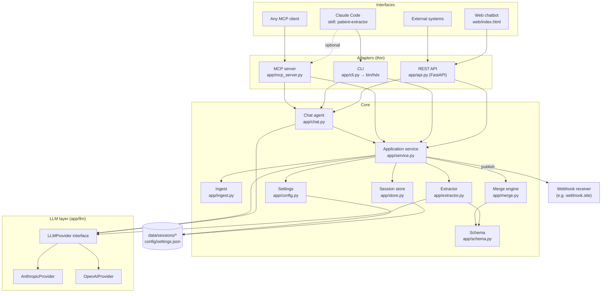
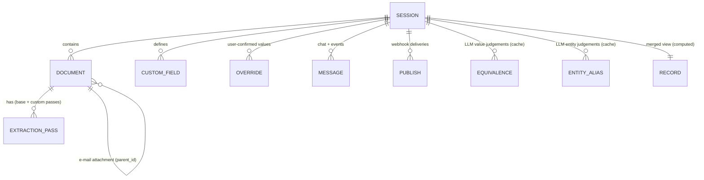
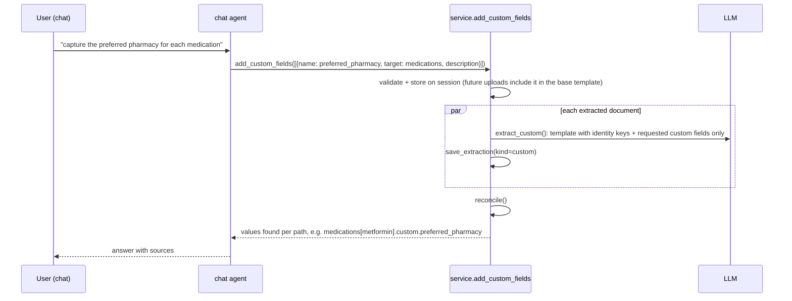

# Patient Data Extractor

An LLM-based proof of concept that turns **heterogeneous healthcare documents** — PDFs, scans and
photos, e-mails with attachments, Word, Excel, CSV, HTML, HL7, free text — into one
**hospital-standard patient JSON record**. Every value keeps **provenance** (which document, which
date). Where documents disagree, **all candidate values are kept and flagged as conflicts**.

Work is organised in **chat sessions**: upload files, read the merged record, ask questions,
request extra (non-standard) data elements, add more files later, and **publish** the record to a
webhook. One core service is exposed through four interfaces: a web chatbot, a REST API, an MCP
server, and a Claude Code skill.

This README is written for the development team. It explains the architecture and the logic in
enough detail to rebuild the system from scratch.

---

## Contents

1. [Capabilities](#1-capabilities)
2. [Quick start](#2-quick-start)
3. [Repository layout](#3-repository-layout)
4. [Architecture overview](#4-architecture-overview)
5. [Domain model](#5-domain-model)
6. [End-to-end flows](#6-end-to-end-flows)
7. [Module reference](#7-module-reference)
8. [The merge algorithm in detail](#8-the-merge-algorithm-in-detail)
9. [LLM usage: prompts, calls and caching](#9-llm-usage-prompts-calls-and-caching)
10. [Persistence](#10-persistence)
11. [Interfaces](#11-interfaces)
12. [Webhook contract](#12-webhook-contract)
13. [Concurrency and error handling](#13-concurrency-and-error-handling)
14. [Extending the system](#14-extending-the-system)
15. [Deployment](#15-deployment)
16. [Deploying to Claude Code (skill + MCP)](#16-deploying-to-claude-code-skill--mcp)
17. [Testing](#17-testing)
18. [Known limitations and roadmap](#18-known-limitations-and-roadmap)

---

## 1. Capabilities

| Requirement | How it is met |
|---|---|
| Extract from PDF, images, other doc formats, e-mails | `app/ingest.py`: PDFs and images are sent to the model natively (vision), so scans, handwriting and photos work. Office, e-mail, HL7 and text formats are converted to text locally. E-mail attachments become separate documents. |
| Non-standard document structures | The extraction prompt doesn't depend on layout. The model maps whatever it reads onto the standard schema. |
| Standard patient JSON | `app/schema.py` defines the hospital schema (demographics, insurance, allergies, conditions, medications, vitals, labs, procedures, immunizations, encounters, care team, social history). |
| Chat session with incremental uploads | Sessions are stored per folder. The record is **re-merged from all stored extractions on every read**, so new files simply add evidence. |
| Same element in several sources, different values | The merge keeps every candidate with its source document and date, marks `conflict: true`, and picks the newest as `value`. |
| User asks for extra data | **Custom fields** attach to the root, an object section, or **every item** of a list section. Existing documents are re-scanned for just those fields. |
| General questions | `ask_documents` answers from the original files, with citations. |
| API, MCP, skills | FastAPI REST, MCP server (stdio), Claude Code skill driving the `bin/hdx` CLI. |
| Two UIs | Native web chatbot (`web/index.html`) and Claude Code (via the skill). |
| Webhook publish | Configured URL is persisted in `config/settings.json`. Every publish carries the same `session_id` and an increasing `publish_sequence`. |
| Pluggable LLM | Provider, model, effort and API key per provider are set in the portal and persisted. Anthropic and OpenAI are implemented. |

---

## 2. Quick start

Requirements: Python 3.11+ (developed on 3.13), [uv](https://github.com/astral-sh/uv) or pip.

```bash
uv venv .venv -p 3.13 && uv pip install --python .venv/bin/python -r requirements.txt
```

Generate the fictional sample case (7 files, multiple formats, deliberate conflicts):

```bash
.venv/bin/python samples/generate_samples.py
```

Run the portal and API:

```bash
.venv/bin/python -m uvicorn app.api:app --port 8000
```

Then:

1. Open http://127.0.0.1:8000.
2. Click **Settings** and set the provider, model, effort and API key. Paste a https://webhook.site URL. Save.
3. Click **+ New session**, drop the files from `samples/case_eleanor_vasquez/` and click **Extract**.
4. Chat, for example:
   - "Summarize the conflicts."
   - "Also capture the preferred pharmacy for each medication."
   - "Dr. Lee confirmed furosemide is 20 mg; record that and publish."

The same flow works from the CLI:

```bash
bin/hdx config --api-key sk-ant-... --webhook https://webhook.site/<uuid>
bin/hdx new --title "Eleanor Vasquez"
bin/hdx add <session_id> samples/case_eleanor_vasquez/*
bin/hdx conflicts <session_id>
bin/hdx publish <session_id>
```

You can also open the folder in **Claude Code**. The `patient-extractor` skill and the MCP server
(`.mcp.json`) are picked up automatically.

For servers, Docker and team rollout see [§15 Deployment](#15-deployment). To install the
skill and MCP server for Claude Code at user level or against a central server, see
[§16 Deploying to Claude Code](#16-deploying-to-claude-code-skill--mcp).

---

## 3. Repository layout

```
app/
  config.py            Settings (provider/model/effort/keys/webhook) persisted to config/settings.json
  llm/
    base.py            Provider-neutral LLMProvider interface, ToolSpec, JSON extraction helper
    anthropic_provider.py  Claude implementation (streaming, adaptive thinking, effort, refusal fallback)
    openai_provider.py     OpenAI implementation (chat completions, reasoning_effort, function tools)
    __init__.py        get_llm(): builds the configured provider from settings
  schema.py            Hospital standard record: object sections, list sections, identity keys, templates
  ingest.py            File -> LLM content parts (+ text, e-mail attachments, transport date)
  extractor.py         Extraction prompts: full document pass and custom-fields-only pass
  store.py             File-based session store (session.json, files, text, extractions)
  merge.py             Deterministic merge: entity matching, provenance, conflicts, equivalence folding
  service.py           Application service: the only API every interface calls (+ reconcile, publish)
  chat.py              Tool-using chat agent for a session
  api.py               FastAPI REST API + serves the portal
  mcp_server.py        MCP server (stdio) exposing the service as tools
  cli.py               `hdx` CLI (JSON output) used by the Claude Code skill
web/index.html         Native chatbot portal (single file, vanilla JS)
bin/hdx                CLI wrapper (uses .venv)
bin/hdx-mcp            MCP server wrapper (stdio; --http for remote)
scripts/install_claude_code.sh              Installs skill + MCP server at Claude Code user level
Dockerfile, docker-compose.yml, .dockerignore  Container deployment (portal + MCP over HTTP)
.claude/skills/patient-extractor/SKILL.md   Claude Code skill (second UI)
.mcp.json              Registers the MCP server for Claude Code
samples/generate_samples.py                 Builds a fictional multi-format case with planted conflicts
tests/test_pipeline.py                      Offline end-to-end test with a fake LLM
config/settings.json   (git-ignored) runtime settings incl. API keys
data/                  (git-ignored) session storage
```

The whole system is about 2,600 lines of Python and JS.

---

## 4. Architecture overview



**Design principles**

- **One service layer.** `service.py` is the only module that the adapters (REST, MCP, CLI) and
  the chat agent call. Adapters only translate I/O. This is how four interfaces stay consistent.
- **LLM for judgement, code for bookkeeping.** The model reads documents and makes semantic
  decisions: what a document says, which values or entities mean the same thing. Deterministic
  code does matching, provenance, conflict flagging, value choice and serialisation. The record is
  reproducible from stored artefacts.
- **Append-only evidence.** Each LLM extraction is stored as an immutable JSON file per document.
  The merged record is a *view* recomputed on every read. Adding files, adding custom fields or
  overriding values never destroys evidence.
- **Cached LLM judgements.** Reconciliation results (equivalent values, entity aliases) are stored
  on the session. Only new, unjudged items are sent to the model.
- **Shared state through files.** The web server, CLI and MCP server are separate processes that
  share `data/` and `config/settings.json`.

---

## 5. Domain model



| Concept | Meaning | Where |
|---|---|---|
| **Session** | One patient / one conversation. Holds documents, chat, custom fields, overrides, caches, publishes. | `data/sessions/<id>/session.json` |
| **Document** | One uploaded file, or an attachment extracted from an e-mail. Carries `document_type`, `document_date`, `author`, `summary`, `status` (`pending`/`extracted`/`error`). | `session.documents[]` |
| **Extraction pass** | Raw JSON returned by the model for one document. `base` = full schema; `custom` = only newly requested custom fields. | `extractions/<doc_id>/<timestamp>_<kind>.json` |
| **Record** | The merged standard JSON. Computed on demand, never stored (except inside webhook payloads). | `merge.merge()` |
| **Field node** | Every leaf in the record: value, sources, conflict flag, candidates. | see §8 |
| **Entity** | One item of a list section (a medication, a lab result, …), identified by an `entity_key`. | `record.<section>[]` |
| **Custom field** | User-requested data element: `{name, description, target, type}`. | `session.custom_fields[]` |
| **Override** | User-confirmed value for a path. Wins over documents. | `session.overrides[]` |
| **Equivalence** | Cached LLM judgement: which normalised values of a field mean the same thing. | `session.equivalences` |
| **Entity alias** | Cached LLM judgement: which entity keys denote the same real-world item. | `session.entity_aliases` |
| **Publish** | One webhook delivery attempt, with sequence number and HTTP result. | `session.publishes[]` |

### Standard schema (`app/schema.py`)

There are two kinds of sections.

**Object sections** are nested objects of scalar fields:

- `patient`: name `{first, middle, last, suffix}`, `date_of_birth`, `sex`, `gender_identity`, `mrn`,
  `other_identifiers`, phone `{home, mobile, work}`, `email`, address `{line1, line2, city, state,
  postal_code, country}`, `preferred_language`, `marital_status`, `race`, `ethnicity`,
  emergency_contact `{name, relationship, phone}`, `primary_care_provider`, `blood_type`, `height`,
  `weight`
- `social_history`: `smoking_status`, `alcohol_use`, `drug_use`, `occupation`, `living_situation`

**List sections** are lists of entities, matched across documents by **identity key** fields:

| Section | Identity key | Other fields |
|---|---|---|
| `insurance` | `member_id` (fallback `payer`) | payer, plan_name, group_number, subscriber_name, relationship, coverage_type, effective_date |
| `allergies` | `substance` | reaction, severity, status, noted_date |
| `conditions` | `name` | icd10, status, onset_date, notes |
| `medications` | `name` (generic, lowercase) | brand_name, dose, route, frequency, status, start/end_date, prescriber, indication |
| `vitals` | `type` + `date` | value, unit |
| `lab_results` | `test` + `date` | value, unit, reference_range, flag, lab |
| `procedures` | `name` + `date` | cpt, performer, facility |
| `immunizations` | `vaccine` + `date` | dose_number, lot |
| `encounters` | `type` + `start_date` | end_date, facility, provider, reason, disposition |
| `care_team` | `name` | role, specialty, organization, phone |

Any section or entity may carry a `custom` object. The root `custom` object holds record-level
custom fields.

---

## 6. End-to-end flows

### 6.1 Upload and extraction

```mermaid
sequenceDiagram
  autonumber
  participant UI as Web / CLI / MCP
  participant S as service.add_files
  participant ST as store
  participant IN as ingest.prepare
  participant EX as extractor
  participant L as LLMProvider
  participant M as merge

  UI->>S: files[(name, bytes)]
  S->>ST: save_file() for each → doc (status=pending)
  par up to 4 documents in parallel
    S->>IN: prepare(filename, bytes)
    IN-->>S: parts (text/image/pdf), text, attachments, hint_date
    S->>ST: save_text(); save attachments as child docs (queued)
    S->>EX: extract_document(parts, custom_fields)
    EX->>L: generate_json(EXTRACTION_SYSTEM, header + parts + template)
    L-->>EX: partial record + document metadata
    S->>ST: save_extraction(kind=base); update doc (type, date, summary, status)
  end
  Note over S: repeat for queued e-mail attachments
  S->>S: reconcile(): entity resolution + value equivalence (LLM, cached)
  S->>M: get_record() → merge(all extractions)
  S->>ST: append "event" message (docs processed, conflict count)
  S-->>UI: documents, conflicts, record
```

The **document date** comes from the model (`document.document_date`). If that is missing, the
e-mail `Date` header (`hint_date`) is used. It drives provenance display and the "newest wins"
rule. Undated documents (for example an insurance card) sort last.

### 6.2 Custom data element



The custom pass returns list items with their **identity fields** (for example `name` for
medications) plus `custom`. The merge therefore attaches the values to the right existing
entities, because a custom pass is just another extraction pass of the same document.

### 6.3 Chat turn

`chat.chat(sid, message)` appends the user message, rebuilds provider-neutral history (`event`
messages become user-role `[event] …` notes), and runs `LLMProvider.run_tools` with 7 tools:
`get_record`, `get_conflicts`, `list_documents`, `ask_documents`, `add_custom_fields`,
`set_field_value`, `publish`. The final text and the list of tool calls are stored as the
assistant message. The system prompt tells the model to publish **only on explicit request**, to
override values **only when the user states the correct value**, and to show every conflict
candidate with its source and date.

### 6.4 Publish

`service.publish(sid)` reads the webhook URL from settings and builds the payload (§12). It POSTs
with `httpx` and records the attempt in `session.publishes` (sequence, publish_id, HTTP status,
error). It also appends an event message. A failed delivery is recorded rather than raised; the
next publish gets the next sequence number.

---

## 7. Module reference

### `app/config.py` — settings

- `config/settings.json` is deep-merged over `DEFAULTS`:
  ```json
  {"llm": {"provider": "anthropic", "model": "claude-opus-5-5", "effort": "medium",
           "max_tokens": 32000, "api_keys": {"anthropic": "", "openai": ""}},
   "webhook": {"url": "", "timeout_seconds": 20}}
  ```
- `update_settings(patch)` validates the provider, effort level and webhook scheme. API keys that
  are empty or masked (contain `•`) in a patch are **ignored**, so the UI can round-trip masked
  keys. Writes are atomic (temp file + rename) with mode `0600`.
- `get_api_key(provider)` checks the stored key first, then the env var (`ANTHROPIC_API_KEY` /
  `OPENAI_API_KEY`).
- `public_settings()` is the UI/API view. Keys are masked, and `api_key_status` reports
  `config | env | missing` per provider. It also includes the provider catalogue and effort levels.
- `HDX_DATA_DIR` and `HDX_CONFIG_DIR` env vars relocate storage (used by tests).

### `app/llm/` — provider layer

`LLMProvider(api_key, model, effort, max_tokens)` has three methods:

| Method | Purpose |
|---|---|
| `generate(system, parts, max_tokens=None) -> str` | Single-turn multimodal call. Raises `LLMError` on truncation, refusal, auth or API errors. |
| `generate_json(system, parts) -> Any` | `generate` + `extract_json` (handles code fences and leading prose). On parse failure it does **one repair call** ("return only corrected JSON"). |
| `run_tools(system, history, tools, execute, max_steps=10) -> ToolRunResult` | Agent loop for one user turn. Tool exceptions are returned to the model as error results instead of failing the turn. |

Content parts are provider-neutral dicts: `{"type":"text"}`,
`{"type":"image","media_type","data"}`, `{"type":"pdf","data","name"}`. Each provider converts them.

**AnthropicProvider**

- Uses `client.messages.stream(...).get_final_message()`, so long outputs never hit HTTP timeouts.
- Sends `thinking={"type":"adaptive"}` and `output_config={"effort": <effort>}`.
- For models that support it (`claude-opus-5-5`, `claude-opus-5`, `claude-fable-5-1`,
  `claude-sonnet-5-5`), uses the beta endpoint with `fallbacks="default"`
  (`server-side-fallback-2026-07-01`). If the model refuses a request, the API re-runs it on a
  fallback model. If the account rejects the parameter, the provider disables it and retries
  without it.
- `stop_reason == "refusal"` raises `LLMError`. `max_tokens` truncation raises `LLMError`.
- Tool loop: appends the assistant's **full content** (text, thinking and tool_use blocks), so
  history is append-only. All tool results of a step go back in one user message.
- Error mapping: auth, model not found, rate limit, other status codes and connection errors each
  become a readable `LLMError`.

**OpenAIProvider**

- Chat Completions. Images become `image_url` data URLs; PDFs become `file` parts.
- `reasoning_effort` is sent for `o*` / `gpt-5*` models. `xhigh` and `max` map to `high`.
- Function-calling tool loop.

`get_llm()` reads settings **on every call**, so a change in the portal takes effect on the next
request in every process.

### `app/ingest.py` — file preparation

`prepare(filename, bytes) -> Prepared(parts, text, attachments, hint_date)`

| Extension | Handling |
|---|---|
| `.pdf` | Sent natively as a document part. `pypdf` text is also kept for `text/<doc>.txt`. |
| `.png .jpg .jpeg .gif .webp` | Image part. Downscaled to 2000 px or re-encoded as JPEG if larger than 4.5 MB. |
| `.tif .tiff .bmp` | Converted to JPEG. |
| `.eml` | Headers (From/To/Cc/Date/Subject) + body (HTML stripped). **Attachments are returned for separate ingestion.** The `Date` header becomes `hint_date`. |
| `.docx` | Paragraphs + tables (merged cells de-duplicated). |
| `.xlsx .xlsm` | Each sheet rendered as `a \| b \| c` rows. |
| `.html .htm` | Tag-stripped text with line breaks. |
| `.csv .tsv` | Pipe-joined rows. |
| `.hl7` | Text; `\r` segment separators become newlines. |
| `.txt .md .json .xml .rtf …` | UTF-8 text. |
| other | Accepted if it decodes as UTF-8; otherwise `ValueError` (document marked `error`). |

### `app/extractor.py` — extraction prompts

- `EXTRACTION_SYSTEM` sets the rules:
  - only facts the document states, and omit what is absent (no nulls);
  - no facts about other people in patient fields;
  - ISO dates;
  - generic lowercase medication names, exact doses, and the *new* dose with `status: changed` when a change is described;
  - normalised lab names;
  - identifiers copied character for character;
  - leave out anything illegible.
- `extract_document` sends a source header (filename, upload time, e-mail date, parent e-mail),
  the content parts, and the **template** from `schema.extraction_template(custom_fields)`. The
  template is a JSON skeleton whose leaves are field hints, with current custom fields placed at
  their targets.
- `extract_custom` uses `schema.custom_template(fields)`: only identity keys + requested custom
  fields.

### `app/store.py` — persistence

See §10. Key API: `create_session`, `get_session`, `mutate(sid)` (context manager:
read-modify-write under a per-session `RLock`, atomic write), `save_file`, `update_document`,
`save_text`/`load_text`, `save_extraction`/`load_extractions`, `list_sessions`, `delete_session`.
IDs: `ses_<12 hex>`, `doc_<10 hex>`. Filenames are sanitised, and session ids are validated
against `[A-Za-z0-9_-]+` (path-traversal guard).

### `app/merge.py` — merge engine

See §8. Public functions:

| Function | Purpose |
|---|---|
| `merge(session, extractions)` | Builds the full record. |
| `simple_values(record)` | Collapses field nodes to plain values (the standard JSON shape). |
| `list_conflicts(record)` | Returns `{path, chosen, candidates[{value, sources["file (date)"]}]}`. |
| `ambiguous_fields(...)` | Input for value reconciliation. |
| `entity_index(...)` | Input for entity resolution. |
| `parse_path("medications[metformin].dose")` | Returns `("medications","metformin","dose")`. |
| `path_str(path)` | The inverse of `parse_path`. |

### `app/service.py` — application service

| Function | Notes |
|---|---|
| `create_session / list_sessions / get_session / rename_session / delete_session` | |
| `add_files(sid, [(name, bytes)])`, `add_file_paths(sid, [paths])` | Store, extract in parallel (`MAX_PARALLEL=4`), process e-mail attachments in follow-up rounds, reconcile, add an event message. |
| `reprocess_document(sid, doc_id)` | Re-run extraction for one document. |
| `get_record(sid)` | `{session_id, title, generated_at, documents, custom_fields, overrides, record, conflicts}` |
| `reconcile(sid)` | Entity resolution, then value equivalence (§9). Returns an error string or `None`, and never raises. |
| `add_custom_fields(sid, fields)` / `remove_custom_field` | Validates name (snake_case) and target. Runs the custom pass on all extracted documents. |
| `set_override(sid, path, value, note)` | Path must start with a known section or `custom`. |
| `ask_documents(sid, question, doc_ids=None)` | Sends the original files plus the question to the model, which answers with citations. |
| `publish(sid, note=None, url=None)` | Webhook delivery (§12). |

### `app/chat.py` — chat agent

Contains the system prompt, 7 `ToolSpec`s, `_execute` (dispatches to `service`), and `_history`
(last 40 messages; leading non-user messages are dropped).

### `app/api.py`, `app/mcp_server.py`, `app/cli.py`

Thin adapters over `service` and `chat` (§11).

### `web/index.html` — native chatbot

Single file, no build step. It loads `marked` + `DOMPurify` from jsDelivr to render assistant
markdown safely.

- **Left:** session list.
- **Centre:** chat thread with upload events, drag-and-drop and a 📎 picker. Pending files are
  shown as chips; pressing *Extract* uploads them.
- **Right:** tabs:
  - *Record*: collapsible sections. Every field shows its source chips (`filename · date`, linking
    to the original file). Conflicts are highlighted with every candidate. Descriptive variants are
    labelled "wording varies". Custom and user-confirmed fields are tagged.
  - *Conflicts*
  - *Documents*: type, date, summary, status
  - *JSON*: links to the values and full JSON
  - *Publishes*: delivery history
- **Settings dialog:** provider, model (with suggestions), effort segmented control, API key per
  provider (masked status), max tokens, webhook URL.
- The last opened session id is kept in `localStorage`.

### Claude Code skill — `.claude/skills/patient-extractor/SKILL.md`

Teaches Claude Code the concepts, the `bin/hdx` commands, and the response rules:

- summarise conflicts as tables with sources and dates;
- choose custom-field targets;
- use `set` only on explicit confirmation;
- publish only on explicit request, after checking the webhook is set;
- never print keys;
- never invent data.

---

## 8. The merge algorithm in detail

`merge(session, extractions)` is pure and deterministic, given the session (overrides, cached
judgements) and the stored extraction passes.

### 8.1 Collect (`_collect`)

For every extracted document, a **source reference** is built:
`{doc_id, filename, document_date, document_type, uploaded_at}`. Then, for every extraction pass
of that document:

1. **Object sections and root `custom`** are walked recursively. Each scalar leaf is added to an
   accumulator bucket keyed by its path, for example `("patient","phone","mobile")`.
2. **List sections:** for each item:
   - Choose key fields: `key`. If the first key value is empty and the section has a
     `fallback_key`, use that instead (insurance: `member_id`, fallback `payer`).
   - Compute key parts with `entity_key_part` (rules below). Skip items without a primary key.
   - `entity_key` = key parts joined with `|`, for example `hba1c|2026-09-01`.
   - `care_team`: a surname-only key ("raman") is aliased to the unique full name with that
     surname ("priya raman") (`_person_aliases`).
   - Apply **LLM entity aliases** from `session.entity_aliases[section]`, following chains up to
     5 levels.
   - Register the document as a source of the entity. Add each attribute at path
     `(section, entity_key, field)`. Identity fields use the entity-key normalisation, so
     "Metformin HCl" and "metformin" are not a conflict.
3. **Overrides** are added last as a candidate whose source is
   `{doc_id: "user", filename: "user override (chat)", document_date: <override date>, note}`.
   For an equivalent value the user's wording replaces the candidate's.

### 8.2 Normalisation (used to decide whether two values are "the same")

`norm_value(field, value)` produces a comparison key. Display values are never altered.

| Kind | Rule |
|---|---|
| Dates (`*date*` fields) | Parsed from 10 formats to ISO `YYYY-MM-DD` (`YYYY-MM` kept). |
| Phones (`*phone*`, `home`, `mobile`, `work`) | Last 10 digits. |
| Everything else | Lowercased; `"500 mg"` becomes `"500mg"`; punctuation removed except `% . /` and decimal points; whitespace collapsed. |

`entity_key_part(section, field, value)`:

| Section | Rule |
|---|---|
| all | Lowercase alphanumerics; dates normalised. |
| `medications` | Drop salt and form words (hcl, succinate, tartrate, sodium, er, xr, tablet, …) and strength tokens. |
| `care_team` | Drop titles (dr, md, rn, np, …). |
| `allergies` | Strip a plural trailing "s" ("penicillins" → "penicillin"). |
| `lab_results` | Join words and map aliases (`hemoglobin a1c`/`a1c` → `hba1c`, `ldl` → `ldlcholesterol`, …). |

### 8.3 Fold equivalent values (`_collapse`)

`session.equivalences[path_str]` maps each normalised value to a canonical normalised value, as
judged by the model. Candidates with the same canonical value are merged: sources are unioned,
the canonical wording is kept, and other wordings are listed in `also_written_as`.

### 8.4 Build the field node (`_node`)

Candidates are sorted by:

1. contains a user override;
2. newest supporting `document_date` (falling back to `uploaded_at`);
3. number of supporting documents.

```jsonc
{
  "value": "<top candidate's value>",
  "conflict": true,           // >1 candidate, not user-resolved, not descriptive/identity
  "variants": true,           // instead of conflict for descriptive or identity fields
  "resolved_by": "user",      // top candidate is a user override
  "sources": [ /* every supporting source, all candidates */ ],
  "candidates": [ { "value": "...", "sources": [ ... ], "also_written_as": [ ... ] } ]  // only if >1
}
```

**Descriptive fields** (`role`, `notes`, `indication`, `organization`, `facility`, `plan_name`,
`occupation`, `living_situation`, …) and **identity fields of list entities** differ only in
wording. They are marked `variants`, not `conflict`.

### 8.5 Assemble (`_finish`)

List sections become arrays of `{entity_key, sources, <field nodes>…, custom: {…}}`. Sections are
emitted in a stable order: `patient`, the list sections, `social_history`, `custom`.

### 8.6 Worked example

| Document (date) | metformin dose |
|---|---|
| Riverside_Discharge_Summary.pdf (2026-08-14) | 500 mg |
| PCP_referral_email.eml (2026-09-03) | 1000 mg |
| HeartCare_intake_form.docx (2026-09-18) | 1000mg |

Normalised values are `500mg` and `1000mg` (two candidates). The 1000 mg candidate has two
sources and the newest date, so it becomes `value: "1000 mg"`, with `conflict: true` and both
candidates listed with their files and dates. If the user says "500 mg is wrong, confirm 1000 mg",
an override is added. The node becomes `resolved_by: "user"` and `conflict: false`, and the
candidates stay for audit.

---

## 9. LLM usage: prompts, calls and caching

| Step | Prompt (location) | Input | Output | Calls |
|---|---|---|---|---|
| Extraction | `EXTRACTION_SYSTEM` (`extractor.py`) | source header + file parts + schema template | partial record + `document` metadata | 1 per document (parallel ×4) |
| Custom pass | `EXTRACTION_SYSTEM` + "only these elements" | file parts + custom template | identity keys + `custom` | 1 per extracted document per request |
| Entity resolution | `ENTITY_SYSTEM` (`service.py`) | per section: entity keys + short descriptions | `{"sections": {sec: [[canonical, alias…]]}}` | 1 per reconcile, only if new keys exist |
| Value equivalence | `RECONCILE_SYSTEM` (`service.py`) | fields with differing values (batches of 60) | `{"items": [{"id", "groups": [[i…]]}]}` | 0–n per reconcile, only unjudged fields |
| Q&A | `ASK_SYSTEM` (`service.py`) | all (or chosen) original files + question | cited answer | 1 per question |
| Chat | `chat.SYSTEM` + 7 tools | last 40 messages | text + tool calls | 1–10 steps per turn |
| JSON repair | inline (`base.py`) | malformed output | corrected JSON | only on parse failure |

**Reconciliation policy.** Both judgement prompts are deliberately **conservative**: "when unsure,
keep separate — a false conflict is safer than a hidden one". They list concrete do/don't
examples, such as different doses, dates, phone numbers, statuses or reactions, or a likely DOB
typo. Results are cached:

- `session.equivalences[path] = {norm_value: canonical_norm}`. A field is re-sent only when a new
  normalised value appears.
- `session.entity_aliases[section] = {alias_key: canonical_key}` and
  `session.entity_judged[section] = [keys already seen]`. A section is re-sent only when it has
  unseen keys.

Merging entities can create new value buckets. That is why entity resolution runs **before** value
equivalence. A reconcile failure never breaks the pipeline: the record is still correct, just
noisier, and the error is reported in the upload event.

**Effort** (`low`…`max`) trades reasoning depth for latency and cost. `medium` handled the sample
case well. Use `high` for messy scans.

---

## 10. Persistence

```
data/sessions/<session_id>/
  session.json                    # see below
  files/<doc_id>__<filename>      # original bytes (uploads and e-mail attachments)
  text/<doc_id>.txt               # local text rendering when available
  extractions/<doc_id>/<UTC timestamp>_<base|custom>.json   # immutable LLM outputs
config/settings.json              # settings incl. API keys (0600, git-ignored)
```

`session.json`:

```jsonc
{
  "id": "ses_887de9dc40c1", "title": "...", "created_at": "...", "updated_at": "...",
  "documents": [{"id": "doc_…", "filename": "...", "stored_name": "...", "size": 0, "uploaded_at": "...",
                 "parent_id": null, "parent_filename": null, "hint_date": null,
                 "status": "pending|extracted|error", "error": null,
                 "document_type": "...", "document_date": "YYYY-MM-DD", "author": "...",
                 "organization": "...", "summary": "..."}],
  "custom_fields": [{"name": "preferred_pharmacy", "description": "...", "target": "medications",
                     "type": "string", "added_at": "..."}],
  "overrides": [{"path": "medications[furosemide].dose", "value": "20 mg", "note": "...", "at": "..."}],
  "messages": [{"role": "user|assistant|event", "content": "...", "ts": "...", "tool_calls": []}],
  "publishes": [{"sequence": 1, "publish_id": "pub_…", "at": "...", "url": "...", "note": null,
                 "status_code": 200, "ok": true, "error": null}],
  "equivalences": {"medications[aspirin].dose": {"81": "81mg", "81mg": "81mg"}},
  "entity_aliases": {"allergies": {"sulfa bactrim": "sulfa drugs sulfamethoxazole trimethoprim bactrim"}},
  "entity_judged": {"allergies": ["penicillin", "sulfa bactrim", "..."]}
}
```

---

## 11. Interfaces

### REST API (`app/api.py`; OpenAPI at `/docs`)

| Method | Path | Body / query | Returns |
|---|---|---|---|
| GET | `/api/settings` | | public settings (keys masked) |
| PUT | `/api/settings` | partial settings | public settings |
| GET | `/api/sessions` | | session summaries |
| POST | `/api/sessions` | `{title?}` | session |
| GET | `/api/sessions/{id}` | | full session |
| PATCH | `/api/sessions/{id}` | `{title}` | session |
| DELETE | `/api/sessions/{id}` | | `{deleted}` |
| POST | `/api/sessions/{id}/files` | multipart `files` (repeatable) | `{documents, conflicts, record}` |
| GET | `/api/sessions/{id}/documents/{doc}/file` | | original file |
| POST | `/api/sessions/{id}/documents/{doc}/reprocess` | | document |
| GET | `/api/sessions/{id}/record` | `?detail=full\|values` | record envelope |
| GET | `/api/sessions/{id}/conflicts` | | conflicts |
| POST | `/api/sessions/{id}/reconcile` | | `{error, conflicts}` |
| POST | `/api/sessions/{id}/chat` | `{message}` | assistant message |
| POST | `/api/sessions/{id}/ask` | `{question, doc_ids?}` | `{answer}` |
| POST | `/api/sessions/{id}/custom-fields` | `{fields:[{name, description, target, type}]}` | `{custom_fields, values, errors}` |
| DELETE | `/api/sessions/{id}/custom-fields/{name}` | | `{removed}` |
| POST | `/api/sessions/{id}/overrides` | `{path, value, note?}` | override |
| POST | `/api/sessions/{id}/publish` | `{note?}` | publish entry |

Error mapping: `KeyError` → 404, `ValueError` → 400, `LLMError` → 502, as `{"detail": "..."}`.

### MCP server (`python -m app.mcp_server` stdio, or `--http` → `http://host:8765/mcp`; `mcp` 2.x `MCPServer`)

Tools: `create_session`, `list_sessions`, `add_files(session_id, paths)`,
`get_record(session_id, detail, section)`, `get_conflicts`, `list_documents`, `ask_documents`,
`add_custom_fields`, `set_field_value`, `chat`, `publish`, `get_settings`, `update_settings_tool`.
All of them return JSON text.

### CLI (`bin/hdx`, JSON on stdout, exit code 1 with `{"error": ...}` on failure)

```
hdx config [--provider P] [--model M] [--effort E] [--api-key K] [--max-tokens N] [--webhook URL]
hdx sessions | new [--title T]
hdx add <sid> <files...>        hdx record <sid> [--full] [--section S]
hdx conflicts <sid>             hdx docs <sid>            hdx reconcile <sid>
hdx ask <sid> "<question>"      hdx custom <sid> --name N --description D [--target T] [--type T]
hdx set <sid> <path> <value> [--note N]   hdx chat <sid> "<message>"   hdx publish <sid> [--note N]
```

### Claude Code

The skill drives the CLI, and `.mcp.json` registers the MCP server. Both share state with the
portal. A session created in Claude Code can be opened in the web UI and the other way round.

---

## 12. Webhook contract

`POST <webhook url>` with `Content-Type: application/json` and headers `X-HDX-Session-Id`,
`X-HDX-Publish-Sequence` and `X-HDX-Publish-Id`.

```jsonc
{
  "event": "patient_record.published",
  "session_id": "ses_887de9dc40c1",      // stable for every publish of this session
  "publish_id": "pub_5168256302ac",      // unique per delivery
  "publish_sequence": 2,                 // 1, 2, 3 … per session
  "is_update": true,                     // publish_sequence > 1
  "published_at": "2026-10-15T02:53:10+00:00",
  "session_title": "Eleanor Vasquez - CHF case",
  "note": null,
  "documents":     [ { "id", "filename", "document_type", "document_date", "author", "organization",
                       "summary", "status", "error", "parent_id", "uploaded_at" } ],
  "custom_fields": [ { "name", "description", "target", "type", "added_at" } ],
  "conflicts":     [ { "path", "chosen", "candidates": [ { "value", "sources": ["file (date)"] } ] } ],
  "record_values": { /* standard JSON, chosen values only */ },
  "record":        { /* full record: field nodes with provenance and candidates */ }
}
```

The receiver decides how to handle repeated publishes, for example: upsert by `session_id`,
ignore `publish_sequence` values lower than the last processed one, or keep the full history. The
sender doesn't retry. Each attempt (success or failure) is logged in `session.publishes` and shown
in the portal.

---

## 13. Concurrency and error handling

- **Within a process:** per-session `RLock` plus atomic file replace. `store.mutate` makes
  read-modify-write safe for the parallel extraction threads.
- **Across processes** (portal, CLI and MCP at the same time): writes are atomic, but there is no
  inter-process lock. Concurrent edits of the *same* session from two processes can lose an update.
  This is acceptable for a proof of concept; see the roadmap.
- **Extraction failures** are isolated per document (`status: error`, `error` message, rest of
  the batch continues). `reprocess` retries a single document.
- **LLM errors** become `LLMError` with readable messages (bad key, unknown model, rate limit,
  refusal, truncation) and surface as HTTP 502, CLI `{"error"}` or MCP text.
- **Reconcile errors** never fail an upload. They are reported in the event message.
- **Tool errors** in chat are returned to the model as `is_error` tool results so it can recover.
- The SDK retries transient API errors (429/5xx/connection) up to 3 times.

---

## 14. Extending the system

| Task | Steps |
|---|---|
| **Add an LLM provider** | Implement `LLMProvider` (`generate`, `run_tools`) in `app/llm/<name>_provider.py`. Add it to `PROVIDERS` in `config.py` (label, env var, models) and to `get_llm()`. |
| **Add a standard field** | Add it to `OBJECT_SECTIONS` / `LIST_SECTIONS[...]["fields"]` in `schema.py`. The template, merge and UI pick it up automatically. Add to `DESCRIPTIVE_FIELDS` if it is free text. |
| **Add a list section** | Add `{key, fields[, fallback_key]}` to `LIST_SECTIONS`. Optionally add key normalisation in `entity_key_part`. |
| **Add a file format** | Add a branch in `ingest.prepare` that returns text or image parts. Add the extension to `SUPPORTED`. |
| **Add an interface** | Call `service` (and `chat.chat` for conversation). Don't put logic in the adapter. |
| **Change conflict policy** | `_node` decides `value` ordering and conflict vs variants. `norm_value` decides sameness. The reconcile prompts decide semantic sameness. |
| **Map to FHIR** | Write a serializer over `simple_values(record)` (or the full record for provenance → FHIR `Provenance`) and call it in `publish`. |

---

## 15. Deployment

The service is a stateless Python process plus a data folder. Every deployment needs:

| Item | Value |
|---|---|
| Runtime | Python 3.11+ with `requirements.txt` (or the Docker image) |
| Portal + REST API | `uvicorn app.api:app` on port **8000** |
| MCP server (optional) | `python -m app.mcp_server` (stdio), or `--http` on port **8765** at path `/mcp` |
| Persistent storage | `HDX_DATA_DIR` (sessions, default `./data`) and `HDX_CONFIG_DIR` (settings incl. API keys, default `./config`) |
| LLM credentials | Set in the portal Settings dialog (persisted), or env `ANTHROPIC_API_KEY` / `OPENAI_API_KEY` |
| Outbound network | LLM API (`api.anthropic.com` / `api.openai.com`) and the webhook host |
| Request timeouts | Uploads run extraction in the request, so allow **≥ 300 s** at any proxy or load balancer |
| Upload size | Allow at least 50 MB request bodies |
| Replicas | **Exactly one** writer per data volume (file storage, see §13) |

> **Security first.** The portal and API have **no authentication**. Never expose them publicly
> as they are. Put them behind a VPN, an authenticating reverse proxy (SSO, or basic auth at
> minimum) and TLS. Use synthetic data only until the production items in §18 are done.

### 15.1 Local / developer machine

```bash
git clone https://github.com/ravikadam/patient-data-extractor.git && cd patient-data-extractor
uv venv .venv -p 3.13 && uv pip install --python .venv/bin/python -r requirements.txt
.venv/bin/python -m uvicorn app.api:app --port 8000
```

Open http://127.0.0.1:8000 and set the provider, model, effort, API key and webhook in Settings.

### 15.2 Docker / Docker Compose

`Dockerfile` builds one image (non-root user, volumes `/data` and `/config`, health check).
`docker-compose.yml` runs two services from it that share the volumes:

| Service | Port | Command |
|---|---|---|
| `portal` | 8000 | `uvicorn app.api:app --host 0.0.0.0 --port 8000` |
| `mcp` | 8765 | `python -m app.mcp_server --http --host 0.0.0.0 --port 8765` |

```bash
export ANTHROPIC_API_KEY=sk-ant-...          # optional: or set it later in the portal
docker compose up -d --build
docker compose logs -f portal
```

To run the CLI inside the container:

```bash
docker compose exec portal python -m app.cli sessions
```

To back up the session data:

```bash
docker run --rm -v patient-data-extractor_hdx-data:/d -v "$PWD":/b alpine tar czf /b/hdx-data.tgz -C /d .
```

Single image without Compose:

```bash
docker build -t patient-data-extractor .
docker run -d -p 8000:8000 -v hdx-data:/data -v hdx-config:/config --name hdx patient-data-extractor
```

### 15.3 Linux VM with systemd and a reverse proxy

```bash
sudo useradd --system --create-home --home-dir /opt/hdx hdx
sudo -u hdx git clone https://github.com/ravikadam/patient-data-extractor.git /opt/hdx/app
cd /opt/hdx/app && sudo -u hdx python3 -m venv .venv && sudo -u hdx .venv/bin/pip install -r requirements.txt
```

`/etc/systemd/system/hdx.service`:

```ini
[Unit]
Description=Patient Data Extractor (portal + REST API)
After=network-online.target

[Service]
User=hdx
WorkingDirectory=/opt/hdx/app
Environment=HDX_DATA_DIR=/var/lib/hdx/data
Environment=HDX_CONFIG_DIR=/var/lib/hdx/config
EnvironmentFile=-/etc/hdx.env
ExecStart=/opt/hdx/app/.venv/bin/uvicorn app.api:app --host 127.0.0.1 --port 8000
Restart=on-failure
StateDirectory=hdx

[Install]
WantedBy=multi-user.target
```

`/etc/hdx.env` is optional and should be mode 600. It can hold `ANTHROPIC_API_KEY=...`. Add a
second unit with `ExecStart=... -m app.mcp_server --http --host 127.0.0.1 --port 8765` if you need
remote MCP.

```bash
sudo systemctl daemon-reload && sudo systemctl enable --now hdx
```

nginx in front of the app (TLS and authentication terminate here):

```nginx
server {
  listen 443 ssl;
  server_name hdx.example.internal;
  # ssl_certificate ...; ssl_certificate_key ...;
  auth_basic "HDX"; auth_basic_user_file /etc/nginx/hdx.htpasswd;   # or SSO (oauth2-proxy)
  client_max_body_size 50m;
  proxy_read_timeout 300s; proxy_send_timeout 300s;

  location /     { proxy_pass http://127.0.0.1:8000; }
  location /mcp  { proxy_pass http://127.0.0.1:8765/mcp; proxy_buffering off; }   # optional remote MCP
}
```

### 15.4 Managed container platforms (ECS, Cloud Run, Azure Container Apps, Kubernetes)

- Build and push the image: `docker build -t <registry>/patient-data-extractor:<tag> . && docker push ...`.
- Mount persistent storage at `/data` and `/config` (EFS, Filestore, Azure Files, PVC). The image
  stores everything there.
- Run **one replica** per volume. Set the request timeout to at least 300 s and allow 50 MB uploads.
- Inject `ANTHROPIC_API_KEY` from the platform's secret manager instead of storing it in the
  portal.
- Run the MCP service as a second container from the same image with the `mcp` command from
  `docker-compose.yml`.
- Health check: `GET /api/settings` returns 200.

### 15.5 Upgrades and operations

- **Upgrade:** `git pull` (or pull the new image), reinstall requirements, restart. Session files
  are read tolerantly, so new keys are added lazily and old sessions keep working.
- **Re-extract after prompt or schema changes:** `POST /api/sessions/{id}/documents/{doc}/reprocess`.
  This adds a new extraction pass; old passes stay on disk.
- **Logs:** uvicorn stdout. Every LLM error is also stored on the document (`error`) or in the
  chat event.
- **Change model or provider in production:** Settings dialog, `PUT /api/settings`, or
  `python -m app.cli config --model ... --effort ...`. Every process picks it up on the next call.

---

## 16. Deploying to Claude Code (skill + MCP)

Claude Code is the second user interface. Two Claude Code mechanisms are used, and they work
independently:

| Mechanism | File | What it gives Claude Code |
|---|---|---|
| **Skill** | `SKILL.md` in a skills directory | Instructions and domain knowledge. Claude runs the `hdx` CLI through its Bash tool. |
| **MCP server** | `.mcp.json` or `claude mcp add` | Typed tools (`create_session`, `add_files`, `get_record`, `publish`, …). |

**How Claude Code finds skills.** Claude Code loads skills from:

- `.claude/skills/<name>/SKILL.md` inside the project it is opened in (project skills, committed
  to git);
- `~/.claude/skills/<name>/SKILL.md` (personal skills, available in every project).

The YAML front matter (`name`, `description`) tells Claude when the skill applies. It is used
automatically when a request matches ("extract the patient data from these PDFs", "what conflicts
are there?", "publish it"), or explicitly with `/patient-extractor`.

**Prerequisite for all options:** the repo is cloned and the venv is installed (§15.1). The skill
calls `bin/hdx`, which runs `.venv/bin/python`.

### Option A — project level (zero install, recommended for developers)

```bash
cd patient-data-extractor
claude
```

- The skill in `.claude/skills/patient-extractor/` is available immediately.
- The MCP server declared in `.mcp.json` is a *project-scoped* server. Claude Code asks once for
  approval to use it. Accept it, or check later with `/mcp` inside Claude Code.
- Try: *"Create a session and extract samples/case_eleanor_vasquez/\*, then show me the conflicts."*

### Option B — user level (use the extractor from any project)

```bash
scripts/install_claude_code.sh
```

The script:

1. copies the skill to `~/.claude/skills/patient-extractor/SKILL.md` and rewrites `bin/hdx` to
   this checkout's absolute path, so it works from any working directory;
2. runs `claude mcp add --scope user patient-data-extractor -- <repo>/bin/hdx-mcp`.

To remove both:

```bash
scripts/install_claude_code.sh --uninstall
```

Re-run the script after pulling skill changes, because the user-level copy doesn't update itself.

Manual equivalent:

```bash
mkdir -p ~/.claude/skills/patient-extractor
sed "s#bin/hdx#$PWD/bin/hdx#g" .claude/skills/patient-extractor/SKILL.md > ~/.claude/skills/patient-extractor/SKILL.md
claude mcp add --scope user patient-data-extractor -- "$PWD/bin/hdx-mcp"
```

### Option C — team access to a central server (remote MCP)

Deploy the `mcp` service (§15.2 or §15.3, behind auth). Each developer then registers it:

```bash
claude mcp add --transport http --scope user patient-data-extractor https://hdx.example.internal/mcp
```

If the proxy uses a token, add `--header "Authorization: Bearer <token>"`.

Notes for remote use:

- All users share the server's sessions and settings, including the configured model and webhook.
- `add_files` takes **paths on the server**, so local files can't be passed by path. Upload them
  through the REST API instead, then continue in Claude Code with the returned session id:
  ```bash
  curl -F files=@discharge.pdf -F files=@labs.xlsx https://hdx.example.internal/api/sessions/<sid>/files
  ```
- The CLI-based skill needs a local checkout. With only a remote server, use the MCP tools. The
  skill's guidance on conflicts, custom fields and publish rules still applies if you install it
  (Option B) for the instructions.

### Verify the installation

```bash
claude mcp list
```

`claude mcp list` should show `patient-data-extractor` as connected. Inside Claude Code, `/mcp`
shows the server and its 13 tools. Then ask: *"List my extraction sessions"* (MCP or skill) and
*"Show the extractor settings"* (uses `hdx config`; API keys are masked).

### Updating or customising the skill

- Edit `.claude/skills/patient-extractor/SKILL.md`. Keep the front-matter `description` specific,
  because it decides when Claude Code picks the skill.
- Commit it: project-level users get it on `git pull`. User-level installs need the install script
  re-run.
- The skill and the portal share `config/settings.json` and `data/`. A session started in Claude
  Code can be opened in the web portal and the other way round.

---

## 17. Testing

```bash
.venv/bin/python tests/test_pipeline.py
```

This is an offline, deterministic end-to-end test. A `FakeLLM` returns canned extractions, and a
local HTTP server stands in for the webhook. It checks:

- multi-document merge;
- normalisation (`06/22/1957` = `1957-06-22`, `Metformin HCl` = `metformin`, `penicillins` = `penicillin`);
- conflict detection (phone, metformin dose, penicillin reaction);
- newest-wins value choice and lab entities split by date;
- custom fields on list items and the root;
- user overrides (`resolved_by`);
- entity aliasing;
- two publishes with the same `session_id` and sequence 1 → 2 plus headers.

**Live check.** Generate the samples and upload them. With `claude-opus-5-5` at `medium`, the 8
documents (including the e-mail attachment) extract in about 50 s. Reconciliation leaves only real
conflicts:

- DOB typo;
- old vs new phone, address and postal code;
- emergency contact name forms;
- weights;
- penicillin reaction;
- metformin dose and status;
- lisinopril discontinued;
- furosemide status;
- ICD-10 I50.22 vs I50.23;
- lb vs kg vitals.

### Sample case (`samples/generate_samples.py`)

A fictional patient, Eleanor M. Vasquez (CHF, type 2 diabetes, CKD 3a), spread over seven files:

1. discharge summary PDF;
2. PCP referral `.eml` with a lab CSV attachment;
3. insurance-card photo (rotated, blurred);
4. patient intake form `.docx`;
5. cardiology labs/vitals `.xlsx` (two sheets);
6. HL7 ADT^A08;
7. handwritten-style scanned prescription `.png`.

Planted issues:

- DOB typo;
- the patient moved (new address and phone);
- metformin 500 → 1000 mg;
- lisinopril → sacubitril/valsartan;
- furosemide 40 → 20 mg;
- penicillin reaction hives vs lip swelling;
- new sulfa allergy;
- self-reported vs measured weight.

Good custom-field demos are preferred pharmacy, code status and advance directive.

---

## 18. Known limitations and roadmap

| Area | Current state (proof of concept) | Production direction |
|---|---|---|
| Security / PHI | No auth, no encryption at rest, keys in a local file. **Synthetic data only.** | SSO/RBAC, secrets manager, encrypted storage, audit log, BAA-covered LLM endpoints |
| Storage | JSON files, single host, no inter-process lock | Postgres (sessions, documents, extraction passes) + object storage for files |
| Throughput | Uploads are synchronous HTTP requests (30–90 s) | Job queue (workers), progress events over SSE/WebSocket |
| Large documents | Whole file per call | Page chunking + per-page provenance; prompt caching for repeated Q&A |
| Provenance granularity | Document + date | Page/quote-level evidence (citations) per field |
| Formats | No `.msg`, `.doc`, `.xls`, DICOM | Add converters (e.g. `extract-msg`, LibreOffice headless) |
| Webhook | Single URL, no retries or signing | HMAC signatures, retries with backoff, multiple subscribers |
| Output standard | Custom JSON schema | FHIR R4 bundle export alongside |
| Evaluation | One offline test + manual live run | Labelled document set; precision/recall per field; regression evals per model/effort |

---

## License

[MIT](LICENSE). The sample documents are fictional; this proof of concept is not intended for real patient data.
